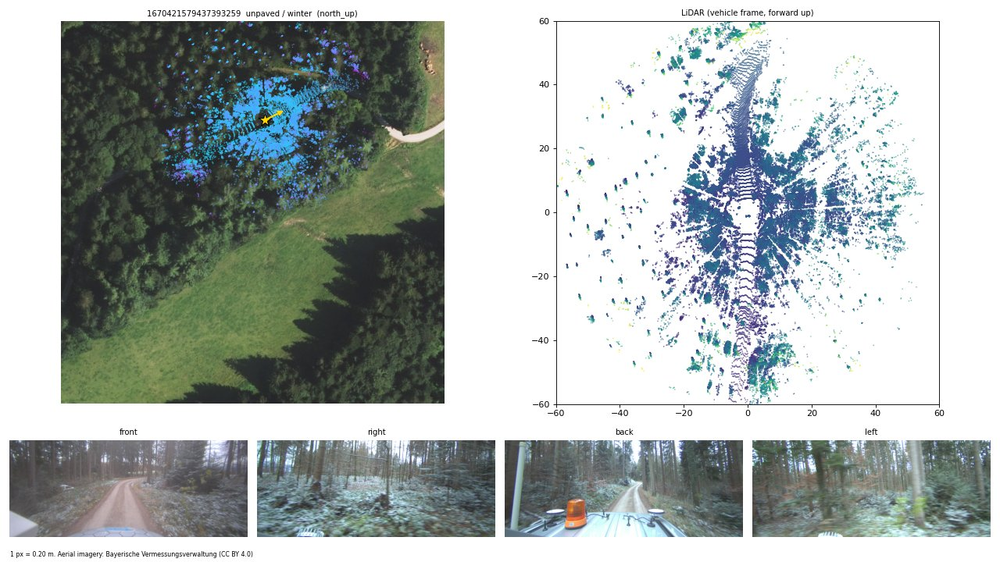

# GOOSELoc: A Multimodal Benchmark for Ground-to-Aerial Localization in Unstructured Off-Road Terrain

WACV 2027

Fabian Deuser, Peter Mortimer, Robin-Nico Kampa, Anna Bößendörfer, Mirko Mählisch,
Martin Werner, Norbert Oswald

This repository contains the data loader, the official evaluation, our baseline
GOOSELocNet and the adapters for the four cross-view baselines of the paper.
The data and all checkpoints are on the Hugging Face Hub at
[Skyy93/GOOSELoc](https://huggingface.co/datasets/Skyy93/GOOSELoc).



<sub>A winter test scene under forest canopy. Gold: ground-truth position and heading; blue: the LiDAR sweep at the ground-truth pose. Aerial imagery: Datenquelle: Bayerische Vermessungsverwaltung – www.geodaten.bayern.de (CC BY 4.0).</sub>

## Abstract

Cross-view pose estimation estimates a ground camera's geographic pose by
matching onboard sensor data with geo-referenced overhead imagery. This is
particularly relevant when GNSS is unreliable, for example under forest canopy
or in urban canyons. Existing metric cross-view benchmarks, such as VIGOR and
cross-view KITTI, are dominated by urban and road scenes with strong human-made
structure without off-road terrain. We introduce GOOSELoc, a multimodal
benchmark for ground-to-aerial localization in unstructured environments,
including forests, fields, and rural tracks. GOOSELoc comprises 9,356 scenes
recorded across all four seasons around Munich, Germany, pairing geo-referenced
aerial orthophotos with surround-view RGB imagery and 3D LiDAR point clouds.
Paved/unpaved labels enable analyzing the impact of terrain structure, while
the seasonal recordings allow studying the appearance gap to mostly
summer-captured orthophotos. To assess the transferability of existing methods,
we adapt and fine-tune four state-of-the-art cross-view localization baselines
on GOOSELoc. Despite task-specific fine-tuning, the performance degrades
substantially in off-road environments. We therefore propose a multimodal
baseline combining surround-view imagery and LiDAR geometry, improving
localization performance and providing a stronger reference for future work.

## Installation

```bash
git clone https://github.com/GOOSELoc/GOOSELoc.git && cd GOOSELoc
pip install -e .              # data loader + evaluation (numpy, pandas, pillow)
pip install -e ".[torch,viz]" # + PyTorch loader and plotting
pip install -e ".[model]"     # + our baseline GOOSELocNet (see docs/MODEL.md for the LiDAR extras)
```

Python ≥ 3.10.

## Download

The dataset and all checkpoints are on the Hugging Face Hub:
[Skyy93/GOOSELoc](https://huggingface.co/datasets/Skyy93/GOOSELoc)
(~75 GB: cameras 40 GB, LiDAR 26 GB, aerial 4.5 GB, checkpoints 4.1 GB).
Download it into `data/GOOSELoc` inside the repository, where the code finds
it without further configuration:

```bash
pip install -U huggingface_hub
hf download Skyy93/GOOSELoc --repo-type dataset --local-dir data/GOOSELoc
gooseloc-check --checksums       # all sensor files present and intact?
```

Only some parts, e.g. a LiDAR-only setup or the checkpoints of one method:

```bash
hf download Skyy93/GOOSELoc --repo-type dataset --local-dir data/GOOSELoc \
    --include "metadata/*" "aerial/*" "lidar/*" "CHECKSUMS.sha256"
hf download Skyy93/GOOSELoc --repo-type dataset --local-dir data/GOOSELoc \
    --include "checkpoints/gooselocnet/*"
gooseloc-check --modalities aerial lidar --checksums
```

The dataset can live anywhere else, too: pass `root=...` / `--root ...` or set
`GOOSELOC_ROOT`. The root is taken from, in this order, the argument,
`$GOOSELOC_ROOT`, and `data/GOOSELoc`. Layout and file formats:
[docs/DATASET.md](docs/DATASET.md#download-and-layout).

The scene table with all ground truth ships with the package, so evaluation
works without any download.

## Quick start

```python
from gooseloc import GOOSELoc

ds = GOOSELoc(split="train", setting="imu_prior")   # root: data/GOOSELoc or $GOOSELOC_ROOT
s = ds[0]
s["aerial"]          # (1024, 1024, 3) uint8, rotated by the noisy heading prior
s["cameras"]         # (4, 1000, 2448, 3) uint8, front, right, back, left
s["lidar"]           # (N, 4) float32, x forward, y left, z up, intensity
s["gt_xy"]           # vehicle position (x, y) in pixels of s["aerial"]
s["gt_heading_deg"]  # heading relative to the tile's up-axis (the residual to predict)
s["meta"]            # terrain, season, date, UTM coordinates, ...
```

Filters and options: `split="test_buffered"`, `terrain="unpaved"`,
`season=["winter", "spring"]`, `modalities=("aerial", "lidar")`,
`cameras=("front",)`, `camera_size=(512, 1216)`, `lidar_max_points=8000`,
`lidar_aug=True`.

PyTorch:

```python
from gooseloc.data.torch_dataset import GOOSELocTorch, make_loader

if __name__ == "__main__":  # needed for worker processes on macOS and Windows
    ds = GOOSELocTorch(split="train", setting="north_up",
                       camera_size=(512, 1216), lidar_max_points=8000, lidar_aug=True)
    for batch in make_loader(ds, batch_size=8, num_workers=8):
        batch["aerial"]    # (B, 3, 1024, 1024) float in [0, 1]
        batch["cameras"]   # (B, 4, 3, 512, 1216)
        batch["lidar"]     # list of (N_i, 4) tensors
```

Visualize a sample of the numpy dataset with
`gooseloc.viz.plot_sample(GOOSELoc(split="test")[0])`. A walk-through is in
[notebooks/getting_started.ipynb](notebooks/getting_started.ipynb).

## Benchmark

Predict the vehicle's position in the aerial crop and its heading, in two settings:

* north-up: the crop is north-aligned; recover the full 360° heading.
* IMU prior: the crop is rotated by the true heading plus an error of up
  to ±10° (fixed per scene for dev/test); recover the residual.

Train on `train`, select on `dev`, report `test` (mean ± std over 3 seeds).
Write one CSV per split with `scene_id,x,y,heading_deg` in the north-up frame and run

```bash
gooseloc-eval predictions.csv --split test
```

which reports mean/median localization error (m) and orientation error (°),
overall, per terrain, per season and on the leakage-free buffered test subset.
Details: [docs/BENCHMARK.md](docs/BENCHMARK.md).

## Results

Test split, mean ± std over three seeds (loc in m, ori in °), as in Table 3 of the paper. Full table with dev:
[results/tables/main.md](results/tables/main.md); terrain, season, buffered and
robustness tables are in [results/tables/](results/tables/).

| Setting | Method | loc mean | loc median | ori mean | ori median |
|---|---|---|---|---|---|
| North-up | Predict center | 39.7 | 41.5 | 90.0 | 90.0 |
|  | CCVPE (surround) | 45.4±2.9 | 37.0±2.9 | 52.8±5.0 | 35.6±17.0 |
|  | HC-Net (surround) | 31.8±0.4 | 28.6±0.2 | 87.0±0.5 | 84.4±1.2 |
|  | FG² (front) | 37.7±1.2 | 35.1±0.8 | 92.0±0.2 | 93.4±0.1 |
|  | FG² (surround) | 34.4±0.4 | 32.1±0.3 | 92.5±0.1 | 93.1±0.3 |
|  | Ours (RGB) | 29.8±0.1 | 25.5±0.1 | 49.0±5.3 | 27.9±3.3 |
|  | Ours (LiDAR-only) | 28.7±0.3 | 24.9±0.8 | 64.3±3.6 | 38.5±5.4 |
|  | **Ours (RGB+L)** | **27.1±0.3** | **22.2±0.6** | **46.3±1.1** | **24.8±0.3** |
| IMU ±10° | Shi et al. (front) | 35.4 | 26.6 | **4.1** | **3.2** |
|  | HC-Net (surround) | 31.9±3.3 | 27.2±0.3 | 15.0±1.5 | 11.7±0.8 |
|  | FG² (front) | 29.2±0.3 | 24.6±0.6 | 6.6±0.1 | 4.8±0.1 |
|  | FG² (surround) | 25.0±0.4 | 20.2±0.6 | 5.1±0.1 | 4.4±0.2 |
|  | Ours (RGB) | 25.1±0.1 | 20.7±0.2 | 4.6±0.1 | 3.9±0.1 |
|  | Ours (LiDAR-only) | 21.2±0.2 | 16.1±0.1 | 4.2±0.1 | 3.5±0.1 |
|  | **Ours (RGB+L)** | **19.5±0.3** | **14.1±0.1** | 4.6±0.1 | 3.8±0.1 |

Re-running the evaluation, e.g. on the per-scene results in `results/per_scene/` or with the
released checkpoints, gives slightly different numbers. This is expected: GPU training and
inference are not fully deterministic, and the camera images were anonymized for the release.

Per-scene errors of every run are in [`results/`](results/).

## Baselines and checkpoints

| method | input | settings | code | checkpoints |
|---|---|---|---|---|
| GOOSELocNet (ours) | 4 cameras / LiDAR / both | both | [`gooseloc/models/gooselocnet`](gooseloc/models/gooselocnet), [docs/MODEL.md](docs/MODEL.md) | 18 (3 variants x 2 settings x 3 seeds) |
| FG² (Xia et al., CVPR 2025) | front / 4 cameras | both | [`baselines/fg2`](baselines/fg2) | 12 |
| CCVPE (Xia et al., TPAMI 2023) | 4-camera panorama | north-up | [`baselines/ccvpe`](baselines/ccvpe) | 3 |
| HC-Net (Wang et al., NeurIPS 2023) | 4-camera panorama | both | [`baselines/hcnet`](baselines/hcnet) | 6 |
| Shi et al. (ICCV 2023) | front camera | IMU prior | [`baselines/shi`](baselines/shi) | 3 |

All checkpoints are part of the Hugging Face download, in
`data/GOOSELoc/checkpoints/<method>/`. Running one and scoring it:

```bash
python scripts/predict.py --checkpoint data/GOOSELoc/checkpoints/gooselocnet/gooselocnet_rgbl_imu_prior_s0.pt \
    --split test --out preds.csv
gooseloc-eval preds.csv --split test
```

The other baselines work the same way with their own `predict.py`; see
[`baselines/`](baselines/).

## Repository layout

```
gooseloc/                 Python package
├── data/                 scene table, readers, geometry/conventions, dataset, PyTorch loader
├── eval/                 official metrics, gooseloc-eval
├── models/gooselocnet/   our RGB / LiDAR / RGB+L baseline
├── resources/            scenes.csv (all ground truth + protocol), calibration.yaml
└── viz.py
baselines/                FG², CCVPE, HC-Net, Shi et al. adapters (upstream code via setup.sh)
configs/gooselocnet/      one training config per paper row
scripts/                  train.py, predict.py
results/                  per-scene results of every method/seed, result tables
notebooks/                getting started
docs/                     dataset, benchmark, model
tests/                    pytest suite (runs without data or GPU)
data/GOOSELoc/            the dataset download (git-ignored)
```

## Citation

```bibtex
@inproceedings{deuser2027gooseloc,
  title     = {{GOOSELoc}: A Multimodal Benchmark for Ground-to-Aerial Localization in Unstructured Off-Road Terrain},
  author    = {Deuser, Fabian and Mortimer, Peter and Kampa, Robin-Nico and B{\"o}{\ss}end{\"o}rfer, Anna and M{\"a}hlisch, Mirko and Werner, Martin and Oswald, Norbert},
  booktitle = {Proceedings of the IEEE/CVF Winter Conference on Applications of Computer Vision (WACV)},
  year      = {2027}
}

@inproceedings{mortimer2024goose,
  title     = {The {GOOSE} Dataset for Perception in Unstructured Environments},
  author    = {Mortimer, Peter and Hagmanns, Raphael and Granero, Miguel and Luettel, Thorsten and Petereit, Janko and Wuensche, Hans-Joachim},
  booktitle = {IEEE International Conference on Robotics and Automation (ICRA)},
  year      = {2024}
}
```

## License

The code in this repository is MIT licensed (see [LICENSE](LICENSE)), with two
exceptions:

* `baselines/fg2` and `baselines/ccvpe` are GPL-3.0 like their upstream code.
* `docs/assets/sample.jpg` contains DOP20 aerial imagery and is licensed under
  [CC BY 4.0](https://creativecommons.org/licenses/by/4.0/):
  Datenquelle: Bayerische Vermessungsverwaltung – www.geodaten.bayern.de.

The dataset combines two sources with different licenses:

| part | license | attribution |
|---|---|---|
| ground data (`cameras/`, `lidar/`) and `metadata/` | [CC BY-SA 4.0](https://creativecommons.org/licenses/by-sa/4.0/), as the GOOSE dataset it is derived from | cite GOOSELoc and GOOSE |
| aerial crops (`aerial/`) | [CC BY 4.0](https://creativecommons.org/licenses/by/4.0/), as the DOP20 source data | Datenquelle: Bayerische Vermessungsverwaltung – www.geodaten.bayern.de |

Each part keeps its own license; there is no single license for the dataset as
a whole. If you redistribute modified ground data, it has to stay under
CC BY-SA 4.0. Aerial crops shown in figures or derived products need the
attribution above. The checkpoints follow the license of the method's code
(GOOSELocNet and Shi et al. MIT, FG² and CCVPE GPL-3.0; for HC-Net see
[baselines/hcnet](baselines/hcnet)). GOOSELocNet uses frozen DINOv3 and Utonia
encoders whose weights are downloaded separately under their own licenses.
Details are in [docs/DATASET.md](docs/DATASET.md#license) and in `LICENSE.md`
of the dataset.

GOOSELoc builds on the [GOOSE dataset](https://goose-dataset.de/) recorded with the
MuCAR-3 vehicle of the Institute for Autonomous Driving (UniBw Munich).
